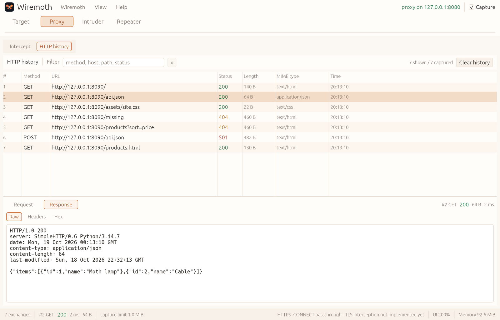

<p align="center">
  <picture>
    <source media="(prefers-color-scheme: dark)" srcset="branding/wiremoth-logo-dark.png">
    
  </picture>
</p>

# Wiremoth

**A lightweight, keyboard-first workbench for inspecting, replaying, and testing HTTP traffic.**

Wiremoth is a Rust-native web security tool for understanding what happens on
the wire: capture a request, inspect it, change it, send it again, and compare
the responses. It is built for web security learning, CTFs, and authorized
application testing — with no embedded browser and memory bounded by design.

> [!IMPORTANT]
> **Status: early prototype.** A loopback-only HTTP/1.1 proxy with editable
> request/response interception, opt-in scope enforcement, match/replace rules,
> local-CA HTTPS interception, and a Burp-style Target/Proxy workspace work
> today. See the [roadmap](docs/roadmap.md).



## What works today

- Loopback HTTP/1.1 proxy with configurable listen address, capture limit,
  interception limit, and count/byte history bounds.
- Editable request and response interception behind one Burp-style **Intercept
  is on/off** control: hold HTTP and decrypted HTTPS messages, edit the head and
  buffered body, then forward or drop. Bodies over the intercept limit stay
  header-only instead of being silently modified.
- Opt-in HTTPS interception with a locally generated certificate authority,
  per-host certificates, a pass-through host list, and documented manual browser
  trust and removal steps. Wiremoth never installs trust automatically.
- Opt-in scope enforcement for HTTP and `CONNECT`, returning `403` for
  out-of-scope hosts. An empty scope allows every host, and enforcement is off
  by default.
- Match/replace rules for request and response heads and buffered UTF-8 bodies,
  using literal text or Rust regular expressions with capture references.
- Burp-style workspace with **Target**, **Proxy**, **Intruder**, and
  **Repeater** tabs in the familiar order, in a warm light theme.
- Bounded in-memory history (exchange count and total captured-body bytes)
  with filtering, a scope view filter, and keyboard navigation (`j`/`k`,
  arrows, `Home`/`End`, `Ctrl`+`F`).
- Live **Memory** indicator in the status bar with allocator memory in use;
  click it for the current and peak values and a rolling graph.
- Request/response tabs with Raw, Headers, and Hex views, truncation markers,
  size, and timing. Raw decodes gzip, deflate, and Brotli bodies for display;
  Hex keeps the original wire bytes.
- Target site map grouped by host and path, plus an editable scope list shared
  by the view filter and the traffic guardrail.
- `CONNECT` tunneling for HTTPS: opaque passthrough by default, decryption with
  a locally generated CA when enabled.
- Read-only Repeater preview and a clearly labelled Intruder preview; no fake
  controls are presented as working features.

## Goal: Burp Suite Community parity

Wiremoth's north star is **feature parity with Burp Suite Community Edition's
manual toolkit**: proxy and history, HTTPS interception, Repeater, Decoder,
Comparer, Sequencer, WebSockets, and Intruder-style fuzzing without artificial
rate limits — adapted to an external browser and a memory-bounded Rust core.

This is a direction, not a current claim. The definition, capability matrix,
and deliberate deviations live in
[Burp Community parity](docs/burp-parity.md).

## Quick start

```sh
cargo run -p wiremoth
```

The proxy listens on `127.0.0.1:8080` and the Wiremoth window opens. Point your
browser — or an extension such as FoxyProxy — at that address for HTTP and
HTTPS. To hold HTTP (and decrypted HTTPS) traffic, open **Proxy > Intercept**
and click **Intercept is off** once to turn interception on. To decrypt HTTPS,
generate and trust the local CA as described in
[HTTPS interception](docs/tls.md).

> Only test systems you own or have explicit permission to test. See
> [Safety and privacy](docs/safety.md).

Detailed setup, CLI flags, HiDPI behavior, and current limitations:
[Getting started](docs/getting-started.md).

## Documentation

| Document | Contents |
| --- | --- |
| [Getting started](docs/getting-started.md) | Build, run, proxy setup, options, limitations |
| [HTTPS interception](docs/tls.md) | Local CA setup, browser trust and removal, pass-through hosts |
| [Design](docs/design.md) | Principles, architecture, technology, performance |
| [Performance and memory](docs/performance.md) | M0 measurements, idle RSS breakdown, and method |
| [Roadmap](docs/roadmap.md) | Milestones from prototype to Community parity |
| [Burp Community parity](docs/burp-parity.md) | Definition of parity, capability matrix, deviations |
| [Safety and privacy](docs/safety.md) | Authorized use, data handling, CA trust |
| [Contributing](CONTRIBUTING.md) | Development setup, checks, project layout |

## Contributing

Contributions, testing feedback, and design discussions are welcome. Start with
[CONTRIBUTING.md](CONTRIBUTING.md). Particularly useful early feedback is
low-memory Linux behavior, HTTP correctness, accessibility, and Repeater
workflow design.

## License

Wiremoth is dual-licensed under either of:

- [MIT License](LICENSE-MIT)
- [Apache License, Version 2.0](LICENSE-APACHE)

`SPDX-License-Identifier: MIT OR Apache-2.0`

Third-party dependencies and assets remain subject to their own licenses.
