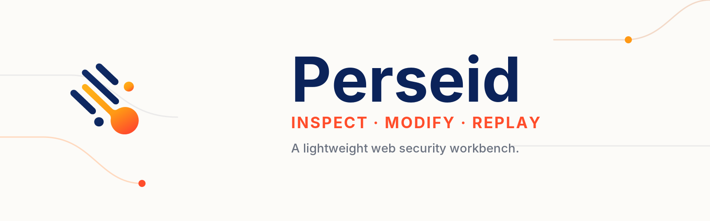
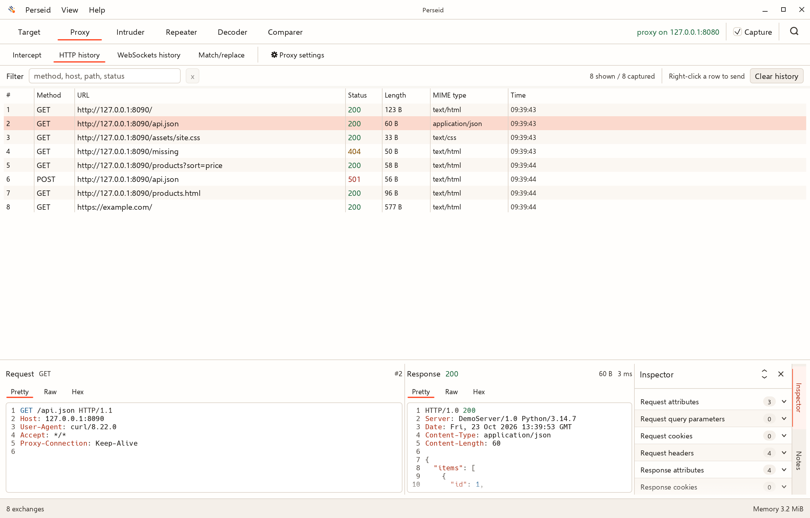

<p align="center">
  
</p>

# Perseid

**An open-source, Rust-native alternative to Burp Suite Community Edition.**

Intercept, inspect, modify, replay, and fuzz HTTP traffic in a lightweight desktop
workbench. Built for security researchers, CTF players, and developers testing
applications they own or are authorized to assess. **No Java runtime or bundled
browser required.**

[](https://github.com/andyintheshell/perseid/actions/workflows/ci.yml)
[](rust-toolchain.toml)
[](docs/roadmap.md)
[](#license)

**[Get started](docs/getting-started.md)** · [Screenshots](docs/screenshots.md) ·
[Feature comparison](docs/burp-parity.md) · [User guide](docs/workbench.md) ·
[Contribute](CONTRIBUTING.md)

[](docs/screenshots.md)

> [!IMPORTANT]
> **Public alpha: the core manual-testing workflows work today.** Perseid is
> actively developed, not yet a feature-complete or drop-in Burp replacement.
> Expect rough edges, and see the [capability matrix](docs/burp-parity.md) for
> an honest account of what is implemented and what is still planned.

## Why Perseid?

- **A familiar manual-testing workflow.** Go from a captured request to
  interception, replay, payload fuzzing, decoding, and comparison in one app.
- **Native and cross-platform.** Built in Rust with egui; CI tests Linux,
  Apple Silicon macOS, and Windows. No JVM or embedded browser.
- **Explicit resource controls.** Configurable capture and in-memory history
  limits, bounded Intruder concurrency, and a live heap-memory indicator.
- **Open development.** Source available under MIT or Apache-2.0; feedback,
  bug reports, and focused contributions are welcome.

## What works today

| Tool | Available today |
| --- | --- |
| **Proxy & HTTP history** | HTTP/1.1 and HTTP/2 forwarding; filtered history; host/path site map; Pretty, Raw, and Hex message views; gzip, deflate, and Brotli decoding. |
| **Search** | Cross-history search of request and response heads and decoded bodies, with case, regex, negative, in-scope, and dynamic-update options; highlighted Pretty/Raw/Hex results. |
| **HTTPS inspection** | Local CA generation, certificate download page, per-host TLS pass-through, and manual trust installation/removal. |
| **Intercept** | Hold, edit, forward, or drop requests and optionally responses, including buffered text bodies. |
| **WebSocket history** | Capture and inspect text and binary frames for `ws://` and decrypted `wss://` connections; no message editing or replay yet. |
| **Repeater** | Editable HTTP/HTTPS requests, multiple tabs, history seeding, target and virtual-host control, and direct replay independent of the proxy. |
| **Intruder** | `$$` payload positions, editable payload sets, Sniper, Battering ram, Pitchfork, and Cluster bomb modes, bounded concurrency, and response inspection. |
| **Decoder** | Stacked encoding/decoding panels, selection-aware transforms, Smart decode, and 31 common hashes. |
| **Comparer** | Text and hex comparison, word- and byte-level diffs, synchronized scrolling, and inputs from history, files, or the clipboard. |
| **Scope & rewriting** | Opt-in proxy scope enforcement, literal/regex match-and-replace rules, and capture/history limits. |

The interface follows **Target → Proxy → Intruder → Repeater → Decoder →
Comparer**. See the [workbench guide](docs/workbench.md) for behavior and
limitations, or browse the [screenshot gallery](docs/screenshots.md).

## Quick start

**Currently built from source.** You'll need **Rust 1.95+** and a desktop with
OpenGL support. Linux, Apple Silicon macOS, and Windows are tested in CI;
packaged installers are not yet available. Check the
[platform requirements](docs/getting-started.md#requirements) before building.

```sh
git clone https://github.com/andyintheshell/perseid.git
cd perseid
cargo run -p perseid --locked
```

1. Perseid opens on **Proxy > HTTP history**, listening on `127.0.0.1:8080`
   by default.
2. Follow the [local HTTP walkthrough](docs/getting-started.md#try-it-with-a-local-target)
   to capture your first request without installing a certificate.
3. For HTTPS, open `http://127.0.0.1:8080/` directly and follow the
   [TLS setup guide](docs/tls.md). Perseid creates a local CA on first launch,
   but **never installs trust automatically**.
4. Configure a dedicated testing browser to use `127.0.0.1:8080` for both
   HTTP and HTTPS. Turn on **Proxy > Intercept** when you want to hold and edit
   requests; it is off by default.

> [!WARNING]
> Test only systems you own or have explicit permission to assess. Use a
> dedicated browser profile. Proxy scope rules **do not apply to direct
> Repeater sends**. Intruder also sends directly, but checks each generated
> request when scope enforcement is enabled. Read
> [Safety and privacy](docs/safety.md) before capturing real traffic.

## Public alpha: current limitations

Perseid is already usable for hands-on HTTP security testing, but there are
important boundaries:

- **No persistent projects yet.** History, Intruder and Repeater results,
  Decoder chains, Comparer items/results, scope, and rewrite settings live in
  memory. The local TLS CA *is* persisted across launches.
- **No WebSocket editing or replay yet.** WebSocket frames can be captured and
  inspected, but not intercepted, modified, or resent.
- **Not an automated scanner.** There is no crawler, automated vulnerability
  scanner, Sequencer, or bundled browser. Intruder sends requests using
  user-supplied payloads; it does not discover vulnerabilities automatically.
- **Some message bodies cannot be edited.** Large, streaming, and binary
  intercepted bodies are header-editable only. Previews and direct-send seeds
  can be truncated or lossy.
- **Performance varies by environment.** Resource limits are configurable,
  but there are no universal memory or speed guarantees. See the
  [measured baseline](docs/performance.md).

Burp Suite Community manual-toolkit parity is a
[direction](docs/burp-parity.md), **not a claim of current feature parity**.
Perseid is independently developed and is not affiliated with or endorsed by
PortSwigger.

## Help build Perseid

Want an open-source Burp-style workbench to improve? **Contributions are
welcome**, whether you're interested in Rust networking, egui, usability,
platform support, tests, or documentation.

- **Try it and report issues:** [Open an issue](https://github.com/andyintheshell/perseid/issues)
  with a minimal reproduction, your OS, and what you expected to happen.
- **Contribute code or documentation:** Read [CONTRIBUTING.md](CONTRIBUTING.md)
  and pick a focused change. HTTP correctness, accessibility, low-memory
  behavior, and macOS/Windows testing are especially useful.
- **Discuss future work:** Read the [roadmap](docs/roadmap.md) and
  [capability matrix](docs/burp-parity.md) before proposing major features.
- **Report vulnerabilities privately:** Follow [SECURITY.md](SECURITY.md).
  Never post live credentials, private keys, or sensitive traffic in issues.

## Documentation

| I want to… | Start here |
| --- | --- |
| Install, build, or configure Perseid | [Getting started](docs/getting-started.md) |
| Learn Proxy, Intruder, Repeater, Decoder, and Comparer | [Workbench guide](docs/workbench.md) |
| Set up HTTPS interception and certificate trust | [TLS guide](docs/tls.md) |
| Troubleshoot setup, traffic, or proxy problems | [Troubleshooting](docs/troubleshooting.md) |
| Compare implemented and planned capabilities | [Burp Community capability matrix](docs/burp-parity.md) |
| Understand the architecture | [Design](docs/design.md) |
| Find all guides and references | [Documentation index](docs/README.md) |

## License

Dual-licensed under [MIT](LICENSE-MIT) **or** [Apache-2.0](LICENSE-APACHE), at
your option. Third-party dependencies, fonts, and assets retain their own
licenses.

`SPDX-License-Identifier: MIT OR Apache-2.0`
