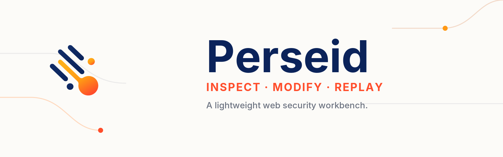
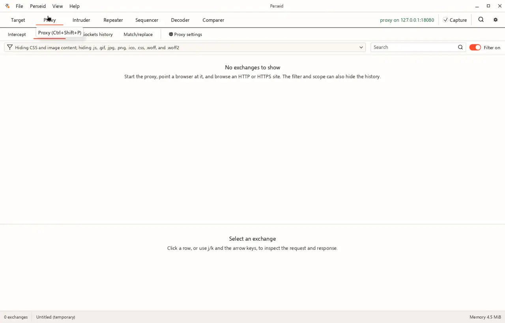

<p align="center">
  
</p>

# Perseid

**An open-source web security workbench. Built in Rust. No Java required.**

Capture HTTP traffic, edit requests, replay them, and fuzz inputs in one desktop
app. For security researchers, CTF players, and developers testing their own apps.

Used Burp Suite Community Edition? You'll recognize the workflow. Perseid is an
independently developed alternative, **not yet a drop-in replacement**.

[](https://github.com/andyintheshell/perseid/actions/workflows/ci.yml)
[](docs/roadmap.md)
[](LICENSE-MIT)
[](https://www.bestpractices.dev/projects/15832)

**[Download](https://github.com/andyintheshell/perseid/releases/latest)** ·
[Get started](docs/getting-started.md) · [Screenshots](docs/screenshots.md) ·
[Documentation](docs/README.md) · [Contribute](CONTRIBUTING.md)

[](docs/screenshots.md)

*A look around the workbench with synthetic traffic. [Browse the screenshots →](docs/screenshots.md)*

> [!NOTE]
> **Public alpha.** Core manual-testing workflows are available today; expect
> rough edges and missing features. This README follows `main`, which may be
> ahead of the latest release. See [current limitations](#current-limitations).

## Why Perseid?

- **One connected workflow.** Capture → inspect → edit → replay, with fuzzing,
  decoding, and comparison alongside it.
- **A native desktop app.** Rust and egui on Linux, macOS, and Windows.
  No JVM or embedded browser; use your own testing browser.
- **Keep your work.** Save traffic and [supported workbench state](docs/workbench.md#projects-and-persistence)
  in a single `.perseid` project file.
- **Open to explore and improve.** MIT or Apache-2.0 licensed, with a public
  [roadmap](docs/roadmap.md) and [capability matrix](docs/burp-parity.md).

## Download and run

**[Get the latest release →](https://github.com/andyintheshell/perseid/releases/latest)**
Prebuilt downloads do not require Rust.

| Platform | Packages | Architecture |
| --- | --- | --- |
| **Windows** | MSI installer or no-install ZIP | x64 / ARM64 |
| **macOS** | DMG | Universal: Intel + Apple Silicon |
| **Linux** | AppImage, DEB, or RPM | x86-64 / ARM64 |

Windows packages are **unsigned**. The macOS app is ad-hoc signed but **not
notarized**, so your OS may warn or block launch. Check the
[platform requirements and installation guide](docs/getting-started.md#requirements)
and the release's `SHA256SUMS.txt` before installing.

<details>
<summary>Prefer Cargo or building from source?</summary>

Both options require **Rust 1.95+** and your platform's
[native build dependencies](docs/getting-started.md#requirements).

Install the latest published crate (compiles locally):

```sh
cargo install perseid --locked
perseid
```

Or run the development version from `main`:

```sh
git clone https://github.com/andyintheshell/perseid.git
cd perseid
cargo run -p perseid --locked
```

</details>

### Capture your first request

1. **Launch Perseid.** The proxy starts at `127.0.0.1:8080`; the app opens on
   **Proxy > HTTP history**. Request holding (**Intercept**) is off by default.
2. **Try a local target.** Follow the
   [HTTP walkthrough](docs/getting-started.md#try-it-with-a-local-target)
   to capture a request without installing a certificate.
3. **Replay it.** Right-click the captured request → **Send to Repeater**.
   Edit the request and send it again.
4. **Connect a testing browser.** Use a dedicated profile and set its HTTP and
   HTTPS proxy to `127.0.0.1:8080`. For HTTPS, open `http://127.0.0.1:8080/`
   directly and follow the [certificate setup guide](docs/tls.md).
   Perseid **never installs certificate trust automatically**.

> [!WARNING]
> Test only systems you own or have explicit permission to assess.
> Proxy scope rules **do not apply to direct Repeater sends**. Intruder sends
> directly too, but checks each generated request when scope enforcement is on.
> Read [Safety and privacy](docs/safety.md) before capturing real traffic.

## What's inside

| Task | Tools and capabilities |
| --- | --- |
| **Explore traffic** | HTTP/1.1 and HTTP/2 proxy, filtered history, Target site map, Pretty/Raw/Hex views, and Copy as curl. |
| **Intercept and edit** | HTTP requests and responses, HTTPS inspection with a local CA, and match/replace rules. |
| **Replay and fuzz** | Multi-tab Repeater; Intruder with Sniper, Battering ram, Pitchfork, and Cluster bomb modes. |
| **Work with WebSockets** | Capture text/binary frames; intercept, edit, and replay messages on live connections. |
| **Search and save** | Cross-history search, regex filters, and persistent `.perseid` projects. |
| **Transform and compare** | Decoder with layered transforms and hashes; Comparer with word- and byte-level diffs. |
| **Examine tokens** | Sequencer with manual/live sampling and randomness analysis. |

See the [workbench guide](docs/workbench.md) for tool walkthroughs and the
[feature comparison](docs/burp-parity.md) for implemented and planned capabilities.

## Current limitations

- **Manual testing, not automated scanning.** No crawler, vulnerability scanner,
  or bundled browser. HTTP/3/QUIC is not supported.
- **Save temporary projects.** They live in RAM and are lost on exit unless
  saved. Retention is unlimited by default, with no automatic memory-pressure
  pause. [Persistence and retention details →](docs/workbench.md#projects-and-persistence)
- **Project files are not encrypted.** They may contain credentials and other
  sensitive traffic. [Deletion is not secure erasure](docs/safety.md#data-handling).
  Back up older projects before [schema upgrades](docs/workbench.md#migrations-and-deletion).
- **Editing has limits.** Large, streaming, or binary HTTP bodies may be
  header-editable only; previews can be truncated. WebSocket replay needs a
  live connection. [Tool limits →](docs/workbench.md#limits-and-persistence)
- **No blanket performance or security guarantees.** Sequencer results are
  indicative, not proof of token safety. Resource controls are configurable;
  see the [measured performance baseline](docs/performance.md).

Found a missing workflow or a bug? [Open an issue](https://github.com/andyintheshell/perseid/issues)
with your OS, reproduction steps, and what you expected.

## Learn more

| I want to… | Start here |
| --- | --- |
| Install or capture my first request | [Getting started](docs/getting-started.md) |
| Learn the tools | [Workbench guide](docs/workbench.md) |
| Set up HTTPS inspection | [TLS guide](docs/tls.md) |
| Fix a setup or traffic problem | [Troubleshooting](docs/troubleshooting.md) |
| See what's next | [Roadmap](docs/roadmap.md) · [Capability matrix](docs/burp-parity.md) |
| Explore the internals | [Design](docs/design.md) |
| Browse every guide | [Documentation index](docs/README.md) |

## Help shape Perseid

Try it in a lab, tell us where the workflow gets awkward, or contribute a focused
fix. Rust networking, egui, accessibility, tests, and platform testing are all
welcome. Start with [CONTRIBUTING.md](CONTRIBUTING.md).

**Reporting a vulnerability?** Follow [SECURITY.md](SECURITY.md) for private
reporting. Never post live credentials, private keys, or sensitive traffic in issues.

## License and trademarks

Source code is dual-licensed under [MIT](LICENSE-MIT) **or**
[Apache-2.0](LICENSE-APACHE), at your option.
Third-party dependencies, fonts, and assets retain their own licenses.

The Perseid name, logos, and visual identity have
[separate brand terms](branding/LICENSE-brand.txt). Forks and modified versions
must replace them with their own branding.

Burp Suite and Burp Suite Community Edition are trademarks of PortSwigger Ltd.
Perseid is independently developed, contains no PortSwigger software or logos,
and is not affiliated with, sponsored by, or endorsed by PortSwigger Ltd.
References to Burp are for comparison only, not a claim of current feature parity.

`SPDX-License-Identifier: MIT OR Apache-2.0`
