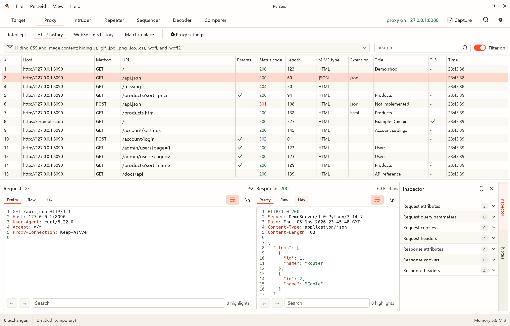

# Burp Suite Community Edition parity

[Documentation](README.md) · [Workbench](workbench.md) · [Roadmap](roadmap.md)

Perseid aims to cover the core **manual web-testing workflows** in Burp Suite
Community Edition (CE), with a Rust-native desktop app and explicit body,
operation, and UI-cache limits. Temporary project storage has configurable
aggregate count and retained-body limits; saved projects offer opt-in logical
limits but no physical disk-size cap. This is a progress snapshot, **not a claim of
full feature or product parity**.

Burp CE's built-in manual toolkit is the comparison point: Proxy, Repeater,
Decoder, Sequencer, Comparer, Intruder, and WebSocket history. See
[PortSwigger's CE feature list](https://portswigger.net/burp/communitydownload).
The goal is an equivalent documented workflow—not an identical UI, internal
implementation, or compatibility with Burp extensions.

**Status key:** ✅ Working · 🟡 Partial · ➕ Beyond CE · 🛠 Planned ·
↔ Deliberate difference · ⛔ Non-goal.

## Parity estimate: 82.1%

As of **2026-11-03**, for the `0.3.1` development build in PR #166,
the estimated parity for the manual-workflow scope below is **82.1%**.
This updates the previous 78.6% snapshot after automated regression tests and
user-confirmed native macOS Decoder smoke testing. The other rows retain their
previous assessment; this is not a new full-toolkit audit or a measurement of all
Burp CE features, reliability, or product maturity.

The calculation gives each of the 14 CE-scope matrix rows equal weight: Working
earns 1 point, Partial earns 0.5, and Planned or missing earns 0. The nine
Working rows are HTTP(S) proxy, intercept and edit, message inspection, scope
and rewrite rules, WebSocket editing and replay, Comparer, Intruder, Decoder, and memory
display. The five Partial rows are target site map, HTTP history, WebSocket
history, Repeater, and Sequencer. Thus **(9 + 5 × 0.5) / 14 × 100 =
82.1%** (rounded to one decimal place). Search and project persistence are
excluded as Perseid extras; bundled browser and BApp compatibility are deliberate
differences outside this project's scoped target. Scanner, crawler, and OAST are
also excluded. These exclusions mean the number must not be read as overall
Burp CE product parity.

Equal weighting and half credit are judgment calls, not measurements of the
fraction of each capability implemented. In particular, a Working row denotes a
usable workflow, not every Burp option: Intruder lacks payload processing, and
WebSocket replay cannot reopen closed connections. The biggest partial gaps
include bounded live-history views, session-only WebSocket Repeater tabs, and
approximate Sequencer analysis. Decoder's binary Hex transfers and Hex-panel
selection transforms are implemented, regression-tested, and manually checked. See the
matrix for details. Recalculate this snapshot when matrix statuses or scope change.

### Decoder promotion check

The binary-selection implementation is covered by headless egui interaction and
workspace round-trip tests. The user confirmed that the native macOS `0.3.1`
development build worked on **2026-11-03** ("Yep, seems to work"). This was
general confirmation after smoke-check instructions, not an item-by-item report;
individual manual results, including save/reopen, were not recorded. Binary
selection persistence is covered by the automated workspace round-trip test.
This is a targeted smoke check, not exhaustive platform or toolkit validation.
Regression checklist (not an itemized record of the manual run):

- Send a Hex selection containing `00 ff` to Decoder with both Append and
  Start new chain; verify byte values, not ASCII `30 30 20 66 66`.
- Drag backwards across Hex rows in both columns; copy the selection and apply
  ASCII hex encoding or a hash. Verify only selected bytes change.
- Save/reopen a project containing non-UTF-8 bytes and a Hex selection; verify
  bytes, selection, and the next transform survive.
- Confirm Raw/Pretty sends remain labeled displayed/derived text, preview
  limits remain bounded, and no transform makes network requests.

## Status at a glance

| ✅ Working | 🟡 Partial | 🛠 Planned |
| --- | --- | --- |
| HTTP/HTTPS proxy and intercept | Bounded live history; site map without crawling/discovery | Full-store live WebSocket table |
| Scope and match/replace; Decoder | Repeater and Sequencer | — |
| Comparer, Intruder, and WebSocket editing/replay | WebSocket history; project persistence | Further project workflow polish |
| Memory display | — | — |

**➕ Perseid extra:** search across stored HTTP/WebSocket history and current
Repeater/Intruder results. **↔ Deliberate differences:** no
bundled browser or Burp BApp compatibility. **⛔ Non-goals:** automated
scanning/crawling and Collaborator/OAST. Sequencer provides a bounded,
expression-based sampling and analysis workflow; it is not a byte-for-byte
reimplementation of Burp's test suite.

Browse the [screenshot gallery](screenshots.md) for Search, Intruder, Repeater,
Decoder, Comparer, and Sequencer.

## Capability matrix

| Capability | Status | What works today / what is missing |
| --- | --- | --- |
| **HTTP(S) proxy** | ✅ Working | HTTP/1.1 and HTTP/2 forwarding; HTTPS interception with a local CA, manual browser trust, and per-host pass-through. Perseid never installs trust automatically. |
| **Intercept and edit** | ✅ Working | Hold, edit, forward, or drop HTTP/1.1 and HTTP/2 requests; response interception is opt-in. Buffered bodies can be edited; streaming or oversized bodies are header-only. |
| **Message inspection** | ✅ Working | Pretty, Raw, and Hex views; bounded gzip, deflate, and Brotli decoding; parsed Inspector and per-exchange Notes. |
| **Scope and rewrite rules** | ✅ Working | Filter views by scope; optionally block out-of-scope proxy requests and `CONNECT` tunnels; recheck edited targets. Match/replace supports literal or regex rules on message heads and buffered UTF-8 bodies. |
| **Target site map** | 🟡 Partial | All retained HTTP history, including old endpoints after reopen. Background disk-backed endpoint indexing; host/folder/resource navigation and Contents independently page 500 summaries, with lazy details, Inspector notes, cURL, and tool sends. Host, Method, URL, Params, Status, Length, MIME, Title, Notes, and Time sorting/search cover the selected subtree. Default display filters and scope apply across retained endpoints. Pause freezes summaries, not capture; retention/clear/project switches invalidate paused views too. Latest means greatest capture ID. No crawler, crawl paths, scanner Issues, parameter discovery, or unrequested-URL inference; expand-all is unavailable for the lazy paged tree. |
| **HTTP history** | 🟡 Partial | One virtual table covers all retained HTTP rows, with full-store metadata filters and lazy details/notes. Search scans retained bodies. Complete captures can be copied as curl. **Delete item** removes a finished exchange and its bodies from the active project; in-flight deletion is disabled. |
| **Search** | ➕ Beyond CE | Search all stored HTTP and WebSocket history plus current Repeater tabs and retained Intruder results, with case, regex, negative-match, in-scope, and live-update filters; stored scans run in the background with progress and stop when superseded. Results highlight in Pretty/Raw/Hex. Query, options, structured result rows, selection, and views persist with a project; old HTTP-only workspaces drop IDs missing from the loaded snapshot. |
| **WebSocket history** | 🟡 Partial | Capture, intercept, edit, forward and drop text/binary messages for `ws://` and decrypted `wss://`. The virtual table covers all retained messages with bounded metadata windows and lazy payload loading. |
| **WebSocket editing and replay** | ✅ Working | Hold and edit text or binary messages in both directions; replay captured messages repeatedly on the existing live connection. Reopening closed connections and fuzzing are not supported. |
| **Repeater** | 🟡 Partial | Editable HTTP/HTTPS requests and live-connection WebSocket replay with text/hex editing and message views. HTTP tabs persist; WebSocket tabs are session-only and cannot reopen closed connections. Direct HTTP sends bypass proxy scope, interception, and rewrite rules. |
| **Decoder** | ✅ Working | Stacked Text/Hex panels, common encode/decode operations, 46 hashes including SKEIN and TupleHash, standard digest OID aliases, Smart decode, and selection-aware transforms in Text and Hex. Projects save panel contents, operation annotations, view, and byte-range selection. History sends full captured messages; message-pane Hex selections transfer original selected binary bytes, while clipboard copies remain hexadecimal text. Raw/Pretty selections are explicitly displayed/derived text, not byte-exact exports. Binary transfers, reverse/multiline Hex selection, and persistence have automated regression coverage; the user confirmed native macOS smoke testing on 2026-11-03. |
| **Comparer** | ✅ Working | Shared item list, word- and byte-level differences, Text/Hex views, difference navigation, and synchronized scrolling. Persistent projects save input items, selections, and result-window state; the diff is recomputed on open. |
| **Intruder** | ✅ Working | `$$` positions; editable or file-loaded payloads; Sniper, Battering ram, Pitchfork, and Cluster bomb; up to 32 concurrent requests with scope checks. Projects save request/payload configuration and result rows. No payload processing. |
| **Sequencer** | 🟡 Partial | Manual token loading and live regex capture from HTTP history; character-level count/transition tests; bit-position and whole-stream tests; effective-entropy chart and per-analysis settings. Capture is expression-based rather than parameter-aware, and the statistical results are bounded approximations. |
| **Memory display** | ✅ Working | Current and peak allocator heap with a rolling graph; this is not total process RSS. |
| **Project persistence** | 🟡 Partial · ➕ Beyond CE | Temporary projects by default; Save As/Open/Save Copy use a local redb `.perseid` file with automatic writes. Saved retention is unlimited by default, with opt-in combined count/body limits; these are not physical file-size caps. Schema v1 migrates atomically to v2. New/Open prompt for unsaved temporary work; failed opens preserve the running proxy. Files are unencrypted. Clear history removes captures; delete a closed project file through the filesystem, not a dedicated UI. Local CA material and transient network activity are not stored. Burp CE itself does not include project files. |

For usage details, limits, and safety behavior, see the
[Workbench guide](workbench.md), [HTTPS guide](tls.md), and
[Safety and privacy](safety.md).

## Deliberate differences

- **External browser:** use a browser or HTTP client configured to proxy through
  Perseid. This avoids bundling Chromium and supports users' existing browser
  profiles and tools.
- **No BApp (Burp App Extension) compatibility:** Burp extensions are Java-based.
  A native extension point may follow core parity; Burp's extension ABI is not a
  target.
- **No artificial Intruder throttle:** Perseid does not copy Burp CE's demo rate
  limit. Concurrency is user-controlled and bounded, and scope checks are
  explicit.
- **Persistence is a Perseid extra:** local `.perseid` projects are implemented
  for captures and project-scoped workbench state, excluding CA material and
  transient network activity. They are not required to match Burp CE; see the
  matrix for current paging, migration, and saved-state limits.

## Milestones

| Milestone | Status |
| --- | --- |
| **M1 — Proxy core** | ✅ Complete: HTTP/1.1 proxy, interception, scope, and match/replace. |
| **M2 — HTTPS** | ✅ Complete: local CA lifecycle, TLS interception, and pass-through. |
| **M3 — Daily workbench** | ✅ Complete for the `0.3.0` release scope: Repeater, Decoder, Comparer, full-store Search, stored HTTP paging, a full-store paged site map, and local project files. Remaining issues moved to M4; completion does not imply full capability parity. |
| **M4 — Protocols and testing tools** | 🟡 Current focus: HTTP/2, WebSocket capture, interception and live-connection replay, Intruder, and Sequencer are available. Full-store WebSocket navigation is implemented. Remaining M3 carryovers include history filters, settings, site map annotations, and recent projects; Decoder transfers are complete with regression and native smoke validation. See the roadmap. |
| **M5 — Parity hardening** | 🟡 In progress: release packages are published; clean-install testing, crash recovery, accessibility, and broader parity audits remain. |

## When does a capability count as parity?

A capability moves to **Working** when it has a usable workflow, practical
automated tests plus a manual check, and documented safety behavior (scope,
retention, and CA trust). Status and user documentation should be updated
together. Testing is limited to local labs or systems you are explicitly
authorized to assess.
