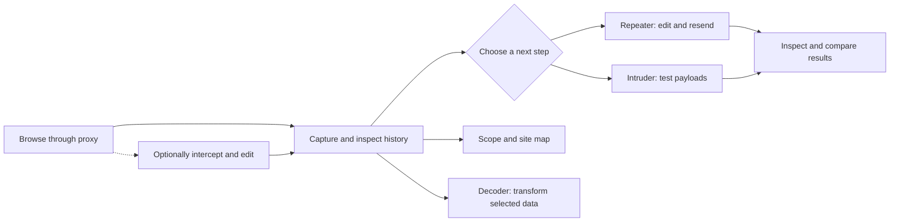

# Burp and ZAP workflows: Perseid implementation and research

[Documentation](README.md) · [Roadmap](roadmap.md) · [Capability matrix](burp-parity.md) · [Workbench guide](workbench.md)

> **Reading this page:** the implementation snapshot and roadmap implications
> were last updated **27 October 2026**. The Burp and ZAP research is
> qualitative, not a representative usage survey; vendor sources were checked **20 October
> 2026**. For current status, use the [capability matrix](burp-parity.md) and
> [roadmap](roadmap.md).

**On this page:** [Manual workflow](#the-manual-workflow) ·
[Implementation snapshot](#perseid-implementation-snapshot) ·
[Roadmap implications](#what-this-means-for-the-roadmap) ·
[Research and comparison](#burp-and-zap-research) · [Sources](#sources)

## The manual workflow

Perseid focuses on the manual testing loop shared by Burp Community Edition
(CE) and ZAP: capture traffic, inspect it, change a request, and compare the
results. The browser retains its own authenticated session; Perseid does not
currently manage or refresh that session for replay.

Interception is optional and occurs as traffic passes through the proxy. HTTP
history and message panes can send data to Decoder; see the
[Workbench guide](workbench.md#decoder) for how text previews, Hex selections,
and captured body bytes differ.

### At a glance

| Area | Snapshot | Next step |
| --- | --- | --- |
| **Core HTTP loop** | Capture, interception, replay, payload testing, comparison, local transforms, and search across stored history are available. | Maintain the loop; finish full-history paging. |
| **Projects and evidence** | Captures and workspace state persist in local project files; HTTP history supports Copy as curl. | Add recent projects, a quit prompt, and useful export formats. |
| **Sessions** | A browser keeps its own cookies; replay can reuse captured headers. | Add a small cookie and session-handling slice. |
| **WebSockets** | Message capture, interception, editing, and live-connection replay work. | Consider new-connection replay and fuzzing. |
| **Automation** | No scanner, crawler, or automation API. | Scanner and crawler are non-goals; extensions and automation are post-parity. |

## Perseid implementation snapshot

**Working** = usable end to end; **Partial** = a foundation with an important
missing part; **Missing** = no usable workflow. The detail and priorities
below reflect the current development branch, not a release checklist.
Burp and ZAP rankings are preserved in the [research section](#burp-and-zap-research).

### The manual testing loop

| Workflow | Perseid snapshot | Priority |
| --- | --- | --- |
| Proxy capture and HTTP history | **Working**: live history uses a bounded snapshot; the stored HTTP browser pages all retained rows and loads details/notes on demand. Search scans all stored HTTP and WebSocket records. Temporary and opt-in saved retention evict oldest eligible captures. | Maintain; selective item deletion |
| Intercept and edit | **Working** for HTTP/1.1 and HTTP/2, including decrypted HTTPS: a Burp-style message table with multi-selection, head and buffered UTF-8 body editing, forward/drop for selected or all messages, optional response interception, and match/replace afterward. WebSocket messages can be held and edited as text or hex. Large, streaming, and binary HTTP bodies are limited. | Maintain |
| Target scope and site map | **Partial**: scope filtering/blocking and saved scope work; the site map indexes all retained HTTP endpoints with bounded host/folder navigation, Contents pages, display filters, and lazy details/tool sends. No crawl, unrequested-URL inference, or parameter discovery. | Maintain; improve discovery separately |
| Repeater / manual request editor | **Working** for HTTP/HTTPS and live WebSocket connections: editable tabs seeded from history, replay, and Pretty/Raw/Hex inspection. Persistent projects save HTTP tabs and their last responses; WebSocket tabs are session-only. Direct HTTP sends bypass proxy scope and rewriting. | Maintain |
| Intruder / fuzzer | **Working** for HTTP/HTTPS: editable `$$` positions, shared or per-position payload sets with file loading, four attack modes, up to 32 concurrent requests, and Pretty/Raw/Hex results. Persistent projects save the request and payload configuration and result rows. No payload processing; enforced scope is checked before and during attacks. | Maintain; add payload processing |
| Decoder / encoder | **Partial**: local transforms work with stacked Text/Hex panels; eight codecs, 46 hashes including SKEIN and TupleHash, standard digest OID aliases, Smart decode, and selection-aware transforms. HTTP history sends full captured messages and message panes send selections. Hex selections currently send displayed hexadecimal text, not binary bytes. Persistent projects save panel contents, operation annotations, view, and selection. 8 MiB input / 16 MiB output caps. | Maintain |
| Comparer / diff | **Working**: one shared item list seeded from history, paste, or file; word/byte diffs; paired Text/Hex result panes with difference navigation and synchronized scrolling. Persistent projects save inputs, selections, and result-window state; the diff is recomputed on open. | Maintain |
| Match/replace rewriting | **Working**: request/response head and buffered UTF-8 body rules, literal or regex, applied after interception. Rules persist in saved projects. | Maintain |

### Supporting workflows and remaining gaps

| Workflow | Perseid snapshot | Priority |
| --- | --- | --- |
| Persistence and search | **Partial**: temporary projects are RAM-only; saved projects autosave to a user-selected `.perseid` file. Saved retention defaults to unlimited but supports opt-in logical limits; no physical disk cap or encryption. Schema v1 upgrades atomically to v2. Search covers all retained HTTP/WebSocket history and tool results; older HTTP rows are pageable. Clear history deletes captures; whole files are deleted through the filesystem when closed. | **M3 — in progress** |
| Authentication and session handling | **Partial**: an external browser keeps its own cookies while proxying; Perseid has no cookie jar, login macro, token refresh, per-user context, or session rules. | **P1 — add to M3/M4** |
| WebSocket testing | **Partial**: bounded history, interception, text/hex editing, and live-connection replay for plain `ws://` and decrypted `wss://`. Saved projects retain messages, but the UI loads a bounded snapshot. No new-connection replay or fuzzing. | **P1 — M4** |
| Evidence capture and reporting | **Partial**: saved projects retain captured exchanges and project-scoped workbench state; HTTP history has a Copy as curl clipboard action. No HAR, save-to-file, or report export. | **P2 — after parity** |
| Sequencer / token analysis | **Partial**: manual and live regex token sampling; character- and bit-level randomness tests; effective-entropy chart and per-analysis settings. No parameter-aware capture; statistics are bounded approximations. | Maintain |

### Outside the current scope

| Workflow | Perseid snapshot | Priority |
| --- | --- | --- |
| Automated scan and alert triage | **Missing**: no scanner, passive checks, or alert management. | **Non-goal** |
| Spidering and crawling | **Missing**: no crawler or automated content discovery. | **Non-goal** |
| Extensions, scripts, and automation/API | **Missing**: no extension point, scripting layer, or automation API. Native extensions are post-parity. | **Post-parity** |

For current feature details, see the [README](../README.md), [Burp parity matrix](burp-parity.md), [roadmap](roadmap.md), and [getting started guide](getting-started.md).

## What this means for the roadmap

### 1. Intruder, Repeater, and Decoder have landed; finish the loop around them

Milestone 3 now includes redb-backed project history/workspace state as well as
search, Repeater, Decoder, and Comparer. The storage foundation has landed, and
Search scans all stored HTTP/WebSocket history plus current Repeater and
Intruder results. Stored HTTP history and the site map page across retained
records/endpoints with lazy details; the live history tables remain bounded snapshots.
The rankings put Repeater first, and editable HTTP/HTTPS replay now exists: a
request can be seeded from history, edited in its own tab, sent directly to the
target, and inspected in Pretty/Raw/Hex. Intruder extends that
workflow with marked positions and payload attacks, including all four attack
types and bounded concurrency. Decoder provides the matching local
transformation surface: stacked panels for URL, HTML, Base64, ASCII hex,
numeric conversions, Gzip, hashes, and Smart decode, with selection-aware
transforms and a replaceable downstream chain. That closes the gaps where the
product stopped after capture or forced payload edits into an external script.

The remaining M3 work should build around that loop rather than repeat it:
full-store WebSocket table navigation, a
recent-project list and quit prompt, and byte-preserving Hex transfers to
Decoder. Comparer now closes the "change one thing and compare" loop with a shared item list and paired
diff views. WebSocket replay uses live connections; project files already
preserve Repeater request tabs and responses, Intruder results, and the other
project-scoped workspace state.

### 2. Add a small session-handling slice

Session and authentication handling ranks seventh in both tools. Perseid can
proxy authenticated browsing because the external browser holds the cookies,
and seeding a Repeater tab copies the selected request's headers, including
`Cookie`. Repeated testing still needs a way to keep that session alive and
refresh credentials. The smallest useful slice is:

- a per-host cookie jar populated from `Set-Cookie`;
- an optional "update cookies from response" behavior;
- later, a simple login macro or re-authentication request.

This is smaller than ZAP's context/authentication model and smaller than Burp's
full session-handling rules, but it removes a blocker that otherwise appears
immediately on real engagements. It should be pulled into M3 or early M4 rather
than left implicit.

### 3. Finish M4's protocol work

Intruder-style fuzzing and Sequencer, the two testing-tool gaps, have landed:
Intruder covers all four Burp attack types, editable payload sets, and bounded
concurrency; Sequencer covers manual and live regex sampling, character- and
bit-level tests, effective-entropy results, and per-analysis settings. That
leaves:

1. **WebSocket message interception and replay** next. Capture/history for
   plain `ws://` and decrypted `wss://` has landed; editing and resending are the
   remaining parts of the same target-dependent workflow.
2. **Session handling and Intruder refinements** such as payload processing
   should follow rather than being displaced by further Sequencer work. Its
   lowest-frequency ranking still makes it a maintain-and-refine tool, not a
   reason to delay the remaining protocol work.

### 4. Treat evidence export as a cheap early win, not a reporting suite

Reporting ranks eighth in ZAP and eleventh in Burp CE. Perseid does not need a
full report generator to cover most of the manual evidence workflow. Copy as
curl has landed for HTTP history; save request/response and HAR export would
cover more of what testers do with captured evidence. A full templated reporting
system can wait until after parity.

### 5. Do not chase ZAP's scanner

ZAP's automated scan is its most prominent workflow, but adding it would change
Perseid's product category, resource profile, and support burden. It is also
explicitly outside Burp CE parity. The existing non-goals — scanner, crawler,
OAST, embedded browser, and BApp binary compatibility — remain correct for this
stage.

The realistic ZAP migration path for Perseid is the **manual** ZAP user:
Manual Explore, Requester, contexts/scope, fuzzer, auth, and import/export. A
scanner-first ZAP user is a different audience and should not drive the
roadmap.

## What would change these priorities

These rankings should be revisited when real usage data exists. The most useful
signals would be:

- **User interviews or opt-in local telemetry** showing whether Perseid users
  spend most of their time browsing, replaying, fuzzing, or exporting.
- **Authentication blockers** reported during Repeater testing. If auth is the
  first thing users hit, the session slice moves ahead of further Comparer
  polish and the remaining Decoder gaps.
- **Target mix.** WebSocket-heavy applications would move WebSocket testing up;
  API-heavy work would move import/export and automation up.
- **Audience mix.** If Perseid attracts CI/AppSec engineers rather than manual
  testers, ZAP's automation and import/export workflows become more important
  than Sequencer.
- **A real public survey** with per-tool, per-workflow usage. None was found for
  this report; vendor onboarding and telemetry are the best available proxies.

## Burp and ZAP research

The following comparison explains the evidence behind the implementation priorities above. Burp CE is primarily a manual toolkit; ZAP also has a prominent automated scanning workflow. The rankings are qualitative and should be read by tier, not as precise usage statistics.

### Research takeaways

- Both tools converge on the same manual loop: **capture traffic, inspect it,
  edit and replay it, then compare the results**. Proxy history is the entry
  point; Repeater (or ZAP's manual request editor) is where most hypotheses are
  actually tested.
- Perseid covers the entry point, editable replay, payload testing, comparison,
  local transformation, and search across stored history: proxy capture,
  interception, scope, message inspection, Repeater, Intruder, Decoder, Comparer,
  Search, and local project files. The remaining daily-workflow gaps include
  full-store WebSocket table navigation, richer session
  convenience, WebSocket message interception/replay, and project workflow
  polish—not scanner coverage.
- Burp CE is explicitly a manual toolkit.[1] PortSwigger calls Repeater and
  Intruder "the center of the Burp Suite manual testing workflow" and says they
  have been "among Burp Suite's most popular tools" since 2003.[11] Burp's
  getting-started path puts scanning and reporting after reissuing requests,
  and marks both steps Pro-only.[2]
- ZAP is scanner-first. Its Quick Start leads with an **Automated Scan** that
  spiders, passively scans, actively scans, and raises alerts.[16] ZAP's
  September 2026 telemetry reports 2.38 million active scans, 6.01 billion
  active-scan messages, and 2.63 billion alerts.[14] Those are aggregate
  counts, not unique desktop users; ZAP also cautions that cloud and desktop
  pings have significantly different profiles.[30] They still show how central
  automated scanning is to ZAP's identity.
- For Perseid, the correct reference point is **Burp CE's manual toolkit**, not
  ZAP's scanner. A scanner, crawler, and OAST workflow should remain deliberate
  non-goals. ZAP's manual request editor, contexts/authentication, import/export,
  and automation are the parts worth learning from after parity.

## How these rankings were built

There is no representative public dataset that reports feature-level usage for
either tool. Burp CE publishes no per-feature telemetry. ZAP publishes aggregate
starts, scans, and messages, but not unique users or a reliable split between
interactive and CI use. ZAP's optional add-on table explicitly says the figures
are installation counts, not usage counts.[15] No credible public survey with
per-workflow percentages was found.

The rankings therefore combine six signals:

1. **Official onboarding and defaults.** What the vendor puts on the first-run
   path, and which workflow its own getting-started guide teaches first.
2. **Vendor emphasis.** Explicit statements about a tool's importance,
   popularity, or role in the manual workflow.
3. **ZAP telemetry.** Aggregate scan and message volumes, treated as evidence of
   scale rather than per-user frequency.
4. **ZAP optional add-on installs.** Demand for capabilities that are not in
   the default install. This is a demand signal, not a usage measurement.
5. **Official documentation and tool surface.** Which workflows have
   first-class buttons, tabs, and guides, and which are buried or Pro-only.
6. **Practitioner consensus.** The repeatable patterns in tutorials, training
   material, and comparison writing, used only to break ties.

Public tutorials and comparison articles were reviewed qualitatively, but were
not treated as representative usage data. The result is a qualitative
prevalence estimate. **Adjacent ranks are not meaningful distinctions; the
tiers are.** Confidence is marked as:

- **High** — multiple independent signals, including official defaults or
  vendor statements.
- **Medium** — strong official presence, but no direct usage evidence.
- **Low** — plausible and documented, but niche or highly target-dependent.

The main limitation is availability bias. A workflow can be rare in Burp CE
because Burp CE does not include it, while being common in ZAP where it is free.
The edition table below makes that distinction explicit before the rankings.

## Edition differences that shape usage

| Workflow | Burp Suite CE | OWASP ZAP | Consequence |
| --- | --- | --- | --- |
| HTTP(S) proxy and history | Yes | Yes | Universal starting point in both tools. |
| Intercept and edit messages | Yes | Breakpoints | Both support hold/edit/forward-style testing. |
| Manual request replay | Repeater | Manual Request Editor and Requester add-on | Core manual workflow in both. |
| Intruder-style fuzzing | Demo, throttled | Fuzzer, free | CE users may use Intruder less than Pro users would; ZAP has no equivalent friction. |
| Passive and active scanning | Pro only | Free | ZAP's signature automated workflow is absent from CE. |
| Spidering and crawling | Pro only | Three spiders: traditional, Client, AJAX | ZAP can discover content automatically; CE cannot. |
| Report generation | Pro only | Report Generation add-on | ZAP users can finish the engagement inside the tool; CE users assemble evidence manually. |
| Project/session persistence | Project files are Pro only | Sessions are recorded to disk, with an explicit persist option | ZAP has built-in session storage; CE has no project files. |
| Search | Pro only | Search tab | ZAP users can search captured traffic; CE users rely on history filters and external notes. |
| WebSocket testing | Proxy/history and Repeater | WebSocket add-on | Both support it; it matters most on real-time applications. |
| Encoder/decoder | Decoder | Encode/Decode/Hash dialog | Common utility in both. |
| Comparison | Comparer | Diff add-on | Common but situational in both. |
| Token analysis | Sequencer | Token Generation and Analysis add-on | Niche in both; Perseid has bounded manual/live sampling and statistical analysis. |
| Extensions/scripts | BApps | Marketplace and scripts | Power-user workflow; ZAP's is free and more automation-oriented. |
| API/daemon/CI | Desktop-first; automation is not a first-class CE workflow | Automation Framework, Docker, GitHub Actions, API/daemon | ZAP is the stronger fit for engineers running repeatable scans in CI. |

Sources: Burp CE feature comparison,[1] ZAP feature map,[17] ZAP getting
started,[16] and ZAP automation documentation.[28]

The availability asymmetry is the single most important caveat in this
research. ZAP's automated scan is not "more popular than Repeater" in some
universal sense; it is the free, default, headline workflow in ZAP, while Burp
CE users do not have a scanner at all.

## Burp Suite Community Edition: ranked workflows

For both tool rankings, ranks 1–4 are the daily core, 5–9 are common testing
workflows, and 10 and below are situational or specialist work. Adjacent
positions within a tier are weaker signals than the tier boundaries.

PortSwigger defines the CE toolkit as a proxy and history, Repeater, Decoder,
Sequencer, Comparer, and a demo version of Intruder.[12] The ranking below
adds the cross-cutting workflows those tools enable.

| Rank | Workflow | Why it ranks here | Confidence |
| --- | --- | --- | --- |
| 1 | **Proxy capture and HTTP history** | The first capability in the CE toolkit and the substrate for every other workflow. Burp's getting-started sequence begins with intercepting traffic and inspecting history. | High |
| 2 | **Repeater: edit and resend** | Step 5 of Burp's getting-started path. PortSwigger describes Repeater as the place to "modify and send an interesting HTTP or WebSocket message over and over" and places it at the center of manual testing.[3][11] | High |
| 3 | **Intercept and edit on the fly** | Step 3 of the official path. Used to bypass client-side controls, change parameters, and test authorization or input handling before the request leaves the browser. | High |
| 4 | **Target scope and site map** | Step 4 of the official path. Scope is both a focus mechanism and a safety boundary; the site map turns captured traffic into an attack-surface view. | High |
| 5 | **Intruder** | Vendor calls Intruder central to the manual workflow and among Burp's most popular tools.[11] It automates customized attacks by inserting payloads into predefined positions.[4] CE ships a demo/throttled version, so its real CE frequency is lower than its Pro reputation suggests.[1][17] | Medium-high |
| 6 | **Decoder** | One of the four "essential tools" listed for CE.[1] Used for tokens, payloads, encoded parameters, and layered transformations.[5] Sometimes handled with other tools or ad-hoc scripts, which keeps it below Repeater. | Medium |
| 7 | **Session and authentication handling** | A prerequisite for testing authenticated applications. Burp provides cookie handling, session-handling rules, and macros in CE.[8] It is cross-cutting rather than a single tab, so it is easy to under-count. | Medium |
| 8 | **Match/replace rewriting** | Built-in request/response rewriting for headers and bodies.[10] Common in access-control, cache, and client-behavior tests, but not used on every request. | Medium |
| 9 | **Comparer** | Compares two requests or responses to expose subtle differences, including username enumeration and Intruder results.[6] High value when needed, but situational. | Medium |
| 10 | **WebSocket testing** | CE includes WebSocket proxy/history and Repeater support for WebSocket messages.[1][3][9] Frequency depends entirely on whether the target uses WebSockets. | Medium-low |
| 11 | **Evidence capture and reporting** | CE has no scanner report generation; testers copy requests/responses, take notes, and assemble evidence manually. This usually happens at the end of an engagement but is not a single built-in workflow. | Medium-low |
| 12 | **Sequencer** | Token randomness analysis for session, CSRF, and reset tokens.[7] Valuable for a narrow class of findings, rarely the main daily activity. | Low-medium |
| 13 | **Extensions and BApps** | Extends the toolkit and is important to power users, but not part of the baseline loop.[1][12] CE supports BApps; Perseid deliberately does not target binary BApp compatibility. | Medium |

The top four form the manual loop. Repeater and Intruder are the two tools
PortSwigger itself singles out as central; Proxy and Target are the surfaces
that feed them. Decoder, session handling, and Comparer are the most common
"supporting" workflows after that. Sequencer and extensions are real parity
items, but they do not determine whether the daily loop is usable.

## OWASP ZAP: ranked workflows

ZAP describes itself as "the world's most widely used web app scanner" and its
default path reflects that scanner-first identity.[13] The ranking below treats
the desktop user's manual workflows as a distinct layer rather than pretending
they compete on the same terms as the automated scan.

| Rank | Workflow | Why it ranks here | Confidence |
| --- | --- | --- | --- |
| 1 | **Automated scan and alert triage** | ZAP's Quick Start centers on a large Automated Scan button: spider, passive scan, active scan, then alerts.[16] September 2026 telemetry shows 2.38M active scans and 6.01B active-scan messages.[14] | High |
| 2 | **Manual explore and proxy history** | The second Quick Start path. ZAP passively scans all proxied traffic while the tester explores with a real browser, builds the site tree, and records alerts.[16] Essential for authenticated and JavaScript-heavy flows. | High |
| 3 | **Sites tree, contexts, and scope** | The Sites tree is ZAP's primary map of discovered content; contexts group URLs and authentication settings for scanning and manual testing.[18] | High |
| 4 | **Manual Request Editor and Requester** | The manual replay equivalent. The Requester add-on is the fourth most-installed optional add-on, and the built-in Manual Request Editor provides the baseline workflow.[15][20] | Medium-high |
| 5 | **Spidering and crawling** | ZAP provides traditional, Client, and AJAX spiders; the Spider add-on is the third most-installed optional add-on, and crawling is also the first stage of the automated scan.[15][16] Automated discovery feeds both scanning and manual exploration. | High |
| 6 | **Fuzzer** | ZAP can fuzz any request with built-in payloads, add-on payloads, custom scripts, payload processors, and message processors.[21] Free and well integrated, unlike CE's throttled Intruder. | Medium |
| 7 | **Authentication and session management** | ZAP's authentication decision tree treats authentication as a prerequisite for reaching protected functionality; the Authentication Helper add-on is sixth in optional installs.[15][19] Contexts bind auth and session settings to URLs. | High |
| 8 | **Import/export and reporting** | Import/Export is the most-installed optional add-on; Postman support is fifth. ZAP also provides report templates and automation support for report generation.[15][23][24] | High |
| 9 | **Encode/decode/hash** | The Encode/Decode/Hash dialog is a built-in utility for URL encoding, Base64, hashes, and many other transforms.[25] | Medium |
| 10 | **API, daemon, and CI automation** | ZAP documents Automation Framework, Docker packaged scans, GitHub Actions, and API/daemon mode as first-class options.[28] This is likely the dominant ZAP workflow for engineers, even if it is not the desktop pentester's daily loop. | High for engineers; low for desktop-only users |
| 11 | **WebSocket testing** | The WebSocket add-on intercepts messages, sets breakpoints, fuzzes frames, and passively scans them with scripts.[22] Important for real-time apps, invisible for most others. | Medium-low |
| 12 | **Diff** | The Diff add-on compares two requests or responses and highlights differences.[26] Useful, but usually replaced by quick manual inspection unless the difference is subtle. | Medium-low |
| 13 | **Token generation and analysis** | The Token Generation and Analysis add-on generates and analyses pseudo-random tokens for session and CSRF testing.[27] A narrow but genuine security workflow. | Low |
| 14 | **Scripts and add-ons** | The Marketplace and scripting support are a major part of ZAP's extensibility, but this is a power-user workflow rather than a baseline step.[16] | Medium |

The ZAP ranking is deliberately different from the Burp ranking. **ZAP's
center of gravity is automated discovery and scanning**, with manual explore,
Requester, and the fuzzer as the manual-testing layer. A single blended ranking
would hide that difference and lead to the wrong roadmap conclusion.

Rows 1 and 5 overlap by design: the automated scan bundles crawling, but users
also crawl separately, and the optional Spider install count is an independent
signal that discovery is a first-class task.

## Sources

All URLs checked 20 October 2026. Bracketed numbers in the text refer to this
list.

1. [Burp Suite Community Edition vs. Professional](https://portswigger.net/burp/communitydownload) — CE feature list, Intruder demo, Pro-only scanner/crawler/project files/search.
2. [Burp Suite getting started](https://portswigger.net/burp/documentation/desktop/getting-started) — official workflow order; scan and report marked Pro-only.
3. [Burp Repeater](https://portswigger.net/burp/documentation/desktop/tools/repeater) — edit and resend HTTP/WebSocket messages.
4. [Burp Intruder](https://portswigger.net/burp/documentation/desktop/tools/intruder) — automated customized attacks.
5. [Burp Decoder](https://portswigger.net/burp/documentation/desktop/tools/decoder) — layered encoding, decoding, and hashing.
6. [Burp Comparer](https://portswigger.net/burp/documentation/desktop/tools/comparer) — compare two items and identify subtle differences.
7. [Burp Sequencer](https://portswigger.net/burp/documentation/desktop/tools/sequencer) — token randomness analysis.
8. [Burp session handling](https://portswigger.net/burp/documentation/desktop/settings/sessions) — cookie handling, macros, and session-handling rules.
9. [Burp WebSocket history](https://portswigger.net/burp/documentation/desktop/tools/proxy/websockets-history) — WebSocket traffic in proxy history.
10. [Burp match/replace](https://portswigger.net/burp/documentation/desktop/tools/proxy/match-and-replace) — request/response rewriting.
11. [PortSwigger: New Repeater features](https://portswigger.net/blog/new-repeater-features-to-help-you-test-more-efficiently) — Repeater and Intruder at the center of manual testing and among Burp's most popular tools.
12. [Burp tools overview](https://portswigger.net/burp/documentation/desktop/tools) — official tool index.
13. [OWASP ZAP](https://www.zaproxy.org/) — "The world's most widely used web app scanner. Free and open source."
14. [ZAP statistics, September 2026](https://www.zaproxy.org/docs/statistics/) — 12,940,524 starts; 2,375,132 active scans; 2,626,808,643 alerts; 6,012,617,078 active-scan messages.
15. [ZAP top add-ons last month](https://www.zaproxy.org/docs/statistics/top-addons-last-month/) — optional add-on install counts, explicitly not usage counts.
16. [ZAP getting started](https://www.zaproxy.org/getting-started/) — Automated Scan, Manual Explore, three spiders, passive scanning, HUD, Marketplace, automation.
17. [ZAP: Burp to ZAP feature map](https://www.zaproxy.org/docs/burp-to-zap-feature-map/) — edition and equivalent-tool comparison.
18. [ZAP contexts](https://www.zaproxy.org/docs/desktop/start/features/contexts/) — grouping URLs and application scope.
19. [ZAP authentication](https://www.zaproxy.org/docs/authentication/) — authentication decision tree and protected-functionality prerequisite.
20. [ZAP Requester add-on](https://www.zaproxy.org/docs/desktop/addons/requester/) — manual request editing and sending.
21. [ZAP Fuzzer](https://www.zaproxy.org/docs/desktop/addons/fuzzer/) — payloads, processors, and request fuzzing.
22. [ZAP WebSockets add-on](https://www.zaproxy.org/docs/desktop/addons/websockets/) — intercept, breakpoints, fuzzing, and passive scanning of WebSocket messages.
23. [ZAP Report Generation](https://www.zaproxy.org/docs/desktop/addons/report-generation/) — templated report generation.
24. [ZAP Import/Export](https://www.zaproxy.org/docs/desktop/addons/import-export/) — HAR, URL, log, and site-tree import/export.
25. [ZAP Encode/Decode/Hash](https://www.zaproxy.org/docs/desktop/addons/encode-decode-hash/) — encoding, decoding, hashing, and custom processors.
26. [ZAP Diff add-on](https://www.zaproxy.org/docs/desktop/addons/diff/) — compare two requests or responses.
27. [ZAP Token Generation and Analysis](https://www.zaproxy.org/docs/desktop/addons/token-generator/) — generate and analyse pseudo-random tokens.
28. [ZAP automation](https://www.zaproxy.org/docs/automate/) — Automation Framework, Docker, GitHub Actions, API, and daemon options.
29. [ZAP Search tab](https://www.zaproxy.org/docs/desktop/ui/tabs/search/) — search captured requests and responses.
30. [ZAP statistics: pie charts](https://www.zaproxy.org/docs/statistics/pie-charts/) — all pings versus desktop-only pings, and the cloud/automation caveat.
