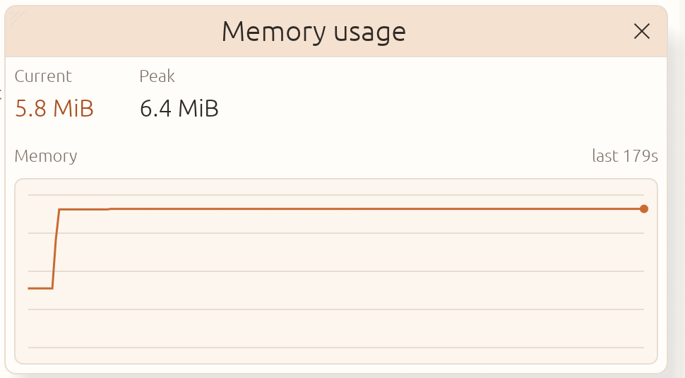

# Performance and memory

Wiremoth aims to stay comfortable on modest hardware. This page records the
Milestone 0 proof-of-concept measurements: idle memory, a full 2,000-entry
history, and viewing large responses.



These are development measurements from one Linux VM, not universal
guarantees. Treat them as a sanity check and a reproducible baseline.

## Milestone 0 results

All figures in the results table are process resident set size (RSS) from Linux
`/proc/<pid>/status` (`VmRSS` and `VmHWM`). The status bar separately reports
allocator heap in use in its **Memory** figure. The proxy was running, capture
was enabled, and the default limits were used: 1 MiB per captured body and
2,000 exchanges in history.

| Scenario | Current RSS | Peak RSS | Notes |
| --- | ---: | ---: | --- |
| Idle, empty history | 92.1 MiB | 93.7 MiB | 15 seconds after startup |
| 2,000 exchanges | 98.9 MiB | 98.9 MiB | 125 KiB in captured bodies; `End` and scrolling checked |
| 8 MiB text response, Raw | 102.6 MiB | 102.6 MiB | 1 MiB captured; 256 KiB text preview |
| 8 MiB text response, Hex | 102.6 MiB | 102.6 MiB | 64 KiB hex dump, virtualized by line |
| 8 MiB binary response, Raw | 104.7 MiB | 108.6 MiB | 1 MiB captured; 8 KiB inline binary preview |
| 8 MiB binary response, Hex | 104.7 MiB | 108.6 MiB | 64 KiB hex dump, virtualized by line |

The 2,000-entry test added about 6.5 MiB over idle. Both large-response tests
stayed under 109 MiB peak even though the wire body was 8 MiB, because capture
stops at 1 MiB and the detail views render bounded previews.

History also has a total retained-body budget. The default is 256 MiB across
request and response bodies (`--history-bytes`), so a worst case of 2,000
exchanges with two full 1 MiB bodies each cannot retain the full 4 GiB. The
oldest exchanges are evicted when either the exchange count or the byte budget
is reached. The M0 workload retained only 125 KiB, so this budget did not bind
in the measurements above.

### Heap in use and resident memory

The status bar's figure is **heap in use**: the bytes currently held by
Wiremoth's allocator. It is the closest equivalent to the memory figure in
Burp Suite's status bar. The memory window adds the peak value and a rolling
three-minute graph; this page keeps RSS for system-level comparison.

With the 2,000-exchange history from the table above, the status bar read
5.8 MiB heap in use (6.4 MiB peak). At the same moment, `/proc` reported
97.9 MiB resident memory: 28.2 MiB anonymous and 69.6 MiB file-backed. The
resident figure is within run-to-run variance of the earlier 98.9 MiB reading.
Heap in use is much smaller than RSS because RSS also counts file-backed
library pages that are shared with other processes and can be reclaimed.

### Findings

- The request table is virtualized, so a full history adds memory for retained
  bodies and metadata, not for laid-out rows. Jumping to the end and scrolling
  through 2,000 rows remained responsive.
- Capture limits dominate large-body memory. An 8 MiB response costs about the
  same as a 1 MiB response once captured.
- The hex view is line-virtualized. Before that change, laying out a 64 KiB
  dump as one text galley peaked at about 182.8 MiB in the text-response
  scenario; with virtualization and allocator tuning, the same view peaks at
  102.6 MiB.
- Binary bodies get a smaller 8 KiB inline preview in Raw to keep the
  non-virtualized text view bounded. The Hex tab still exposes a 64 KiB dump.
- glibc was creating extra malloc arenas for the UI and proxy threads. Limiting
  the process to two arenas with `mallopt(M_ARENA_MAX, 2)` reduced idle RSS by
  about 8.3 MiB, from 100.4 to 92.1 MiB.
- The About lockup is now decoded only when that window opens, instead of
  keeping a 1200x320 texture ready from startup.

### Where idle RSS goes

Process RSS counts mapped file pages as well as the heap. The idle 92.1 MiB on
the reference VM breaks down roughly as follows:

| Mapping | RSS |
| --- | ---: |
| `libLLVM` (Mesa shader compiler) | 44.6 MiB |
| `libgallium` (Mesa graphics driver) | 12.0 MiB |
| Wiremoth executable | 7.8 MiB |
| `[heap]` mapping | 11.3 MiB |
| Anonymous mappings (stacks, buffers) | 6.0 MiB |
| Other libraries and mappings | 10.4 MiB |
| **Total** | **92.1 MiB** |

`/proc/self/status` also splits the resident total into anonymous and
file-backed bytes. Idle, roughly 23 MiB is anonymous (allocator heap, thread
stacks, and private buffers) and the remaining 69 MiB is file-backed (the
executable, Mesa, and other mapped libraries). The allocator tracker reports
about 3 MiB in use at idle; anonymous RSS is larger because it also includes
allocator slack, stacks, and buffers.

The two Mesa mappings are not Wiremoth's data; they are the system graphics
driver. On this VM, the VMware `vmwgfx` driver uses Mesa's LLVM shader
compiler. Forcing the llvmpipe software path raised idle RSS to about 186 MiB,
so it is not a lower-memory fallback here. Other GPUs and driver versions will
report different totals.

Proportional set size (PSS) at the same moment was 86.9 MiB. RSS measures the
whole process, including mapped library code and driver pages, not just the
application's live data; that is why the status bar reports heap in use, while
this page keeps RSS for system-level context. Results will vary with fonts,
graphics drivers, desktop settings, and captured content.

## Test environment

| Item | Value |
| --- | --- |
| System | Kali GNU/Linux Rolling, arm64, VMware virtual machine |
| CPU / memory | 4 vCPU / 5.3 GiB RAM |
| Kernel | Linux 7.1.5 |
| Display | X11, 2880x1800 at 200% UI scale |
| Window | 1280x820 logical points (2560x1640 physical pixels) |
| Toolchain | rustc 1.95.0, release build |
| Wiremoth limits | 1 MiB capture limit, 2,000 exchange history |

## Method

Build and start a release binary:

```sh
cargo build --release -p wiremoth
GDK_SCALE=2 QT_SCALE_FACTOR=2 ./target/release/wiremoth \
  --listen 127.0.0.1:8080 \
  --capture-limit 1048576 \
  --history-limit 2000
```

For an external reading, locate the process and read its resident memory:

```sh
PID=$(pgrep -n -f './target/release/wiremoth')
grep -E 'VmRSS|VmHWM|RssAnon|RssFile|RssShmem' "/proc/$PID/status"
```

Wait 15 seconds after startup for the idle reading. Generate traffic through
the proxy and wait a few seconds for the UI to apply the events. The in-app
**Memory** indicator opens the **Memory usage** window, which shows the
current and peak heap in use and a rolling graph. The resident figures in this
document came from `/proc`, not the window. The mapping breakdown above was
read from `/proc/<pid>/smaps` and `/proc/<pid>/smaps_rollup`.

History was filled with 2,000 sequential loopback requests:

```sh
curl -sS -x http://127.0.0.1:8080 -o /dev/null \
  'http://127.0.0.1:8090/api.json?i=[1-2000]'
```

Large-response tests used two 8 MiB files served by a loopback Python server:
a repeated-text file for the Raw text view and random bytes for the binary
preview and Hex view. Each was requested through Wiremoth with the default
capture limit, then opened in the response pane.

No external hosts were contacted for these measurements. See
[Getting started](getting-started.md) for the normal workspace workflow and
[Design](design.md) for the memory-bounding principles behind these limits.
