# Screenshots

[Documentation](README.md) · [Workbench guide](workbench.md) ·
[Getting started](getting-started.md)

These full-window scenes are generated deterministically by
`scripts/screenshots.sh`. CI uploads the images as an artifact. Same-repository
pull requests get one comment linking to the gallery's exact preview commit;
later runs do not change that gallery. The images are not embedded in the PR
thread. Forks can use workflow artifacts. Traffic and credentials in these
scenes are synthetic.
The main scenes are captured at 2× and saved at native resolution (2560×1640)
for HiDPI displays; the memory panel is a smaller close-up. Screenshots
illustrate the UI, not platform support or performance guarantees.

[History](#proxy--http-history) · [Projects](#projects) · [Search](#search) ·
[WebSockets history](#proxy--websockets-history) · [Intercept](#proxy--intercept) ·
[Intruder](#intruder) · [Repeater](#repeater) · [Sequencer](#sequencer) ·
[Sequencer result](#sequencer-result) · [Decoder](#decoder) · [Comparer](#comparer) ·
[Comparer result](#comparer-result) · [Memory](#memory-usage)

## Proxy > HTTP history

The request and response editors open side by side, with the parsed Inspector
on the right and per-exchange Notes behind its rail tab. The detail split
defaults to roughly half of the workspace. The filter bar above the table opens
Burp-style display filters for scope, MIME and status classes, search terms, and
file extensions; the search field beside it narrows the visible rows directly.
As in Burp, CSS and image responses plus common static extensions are hidden by
default.

## Projects

Perseid starts with a temporary in-memory project (`Untitled (temporary)` in
the status bar). **File > Save Project As…** moves it into a single `.perseid`
file; **Open Project…** switches to an existing one, and **Save Project
Copy…** snapshots it into a new file. Once saved, captures and workbench state
commit automatically, and the status bar shows the open project.

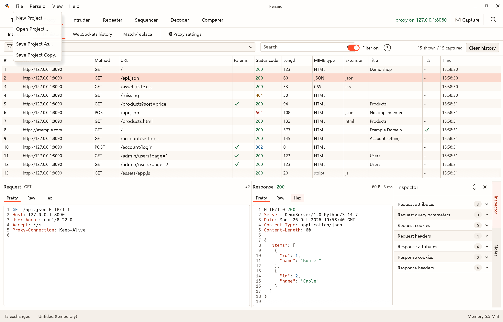

The save dialog is a modal folder browser with a **Save in** location bar,
list and grid views, and file-name and file-type fields. It asks before
replacing an existing file, and the destination only becomes the open project
once the complete copy is ready.

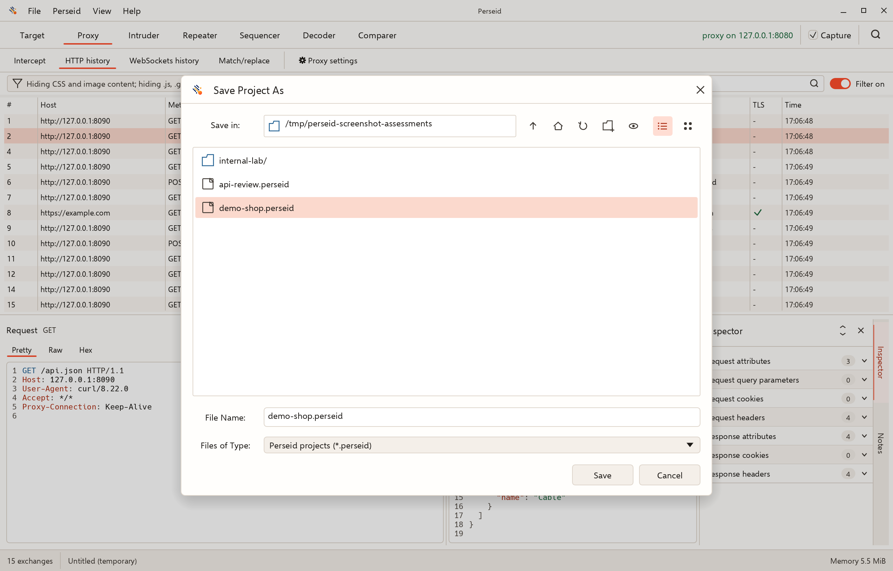

## Search

The top-toolbar magnifier opens a floating search window over stored HTTP and
WebSocket history plus current Repeater and Intruder traffic. Search request or
response heads and decoded bodies, then inspect the selected result in Pretty,
Raw, or Hex with matches highlighted.

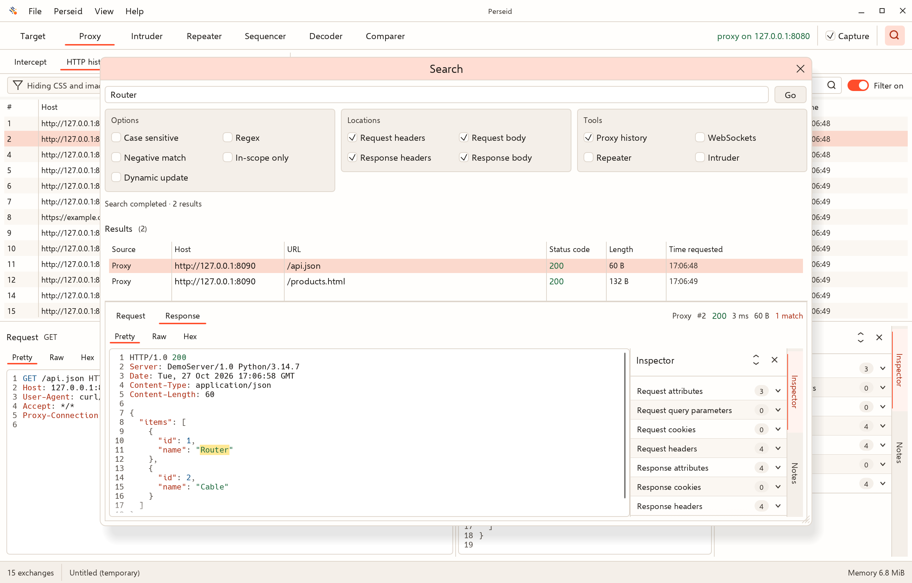

## Proxy > WebSockets history

A separate message-level history for plain `ws://` and decrypted `wss://`
traffic, with direction, length, TLS, time, listener port, and WebSocket ID.

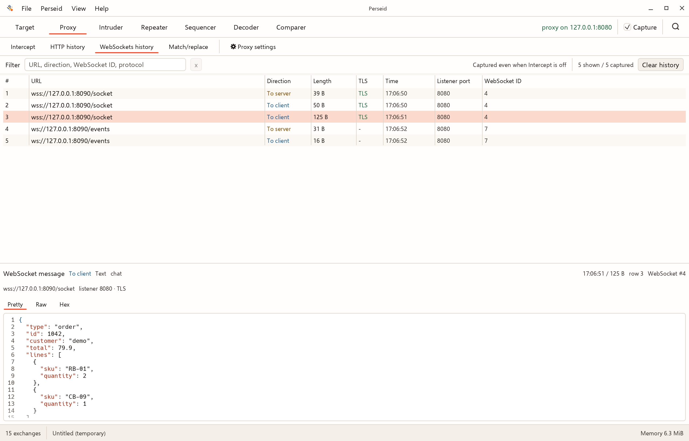

## Target > Site map

The Burp-style URL-view tree, display-filter bar, sortable Contents table, and
shared request/response detail panes.

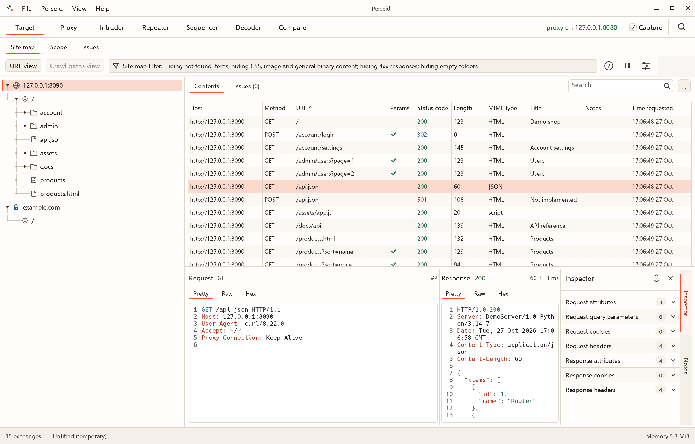

## Target > Scope

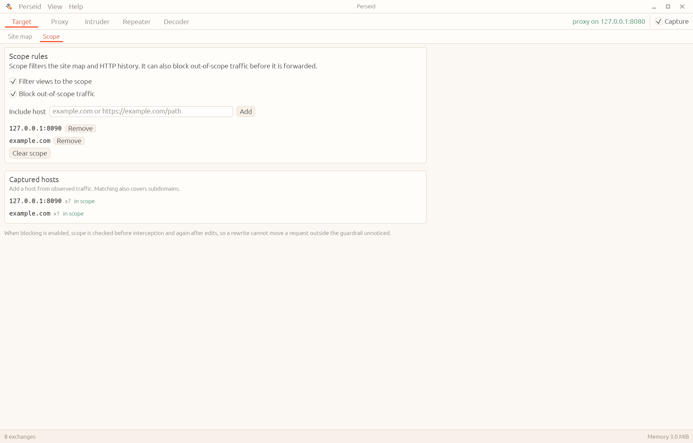

## Proxy > Intercept

Hold messages in a table; select a row to inspect or edit its Raw representation.

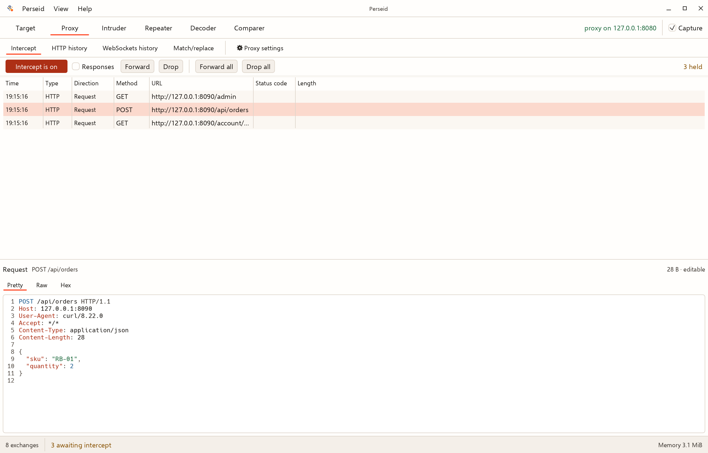

## Proxy > Match/replace

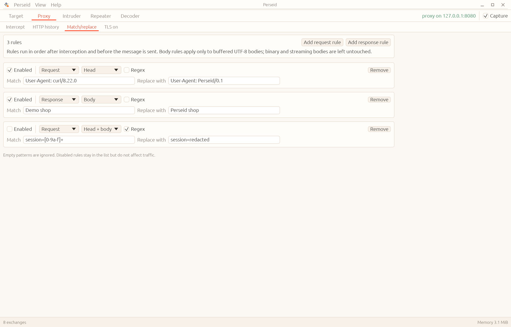

## Proxy > Proxy settings

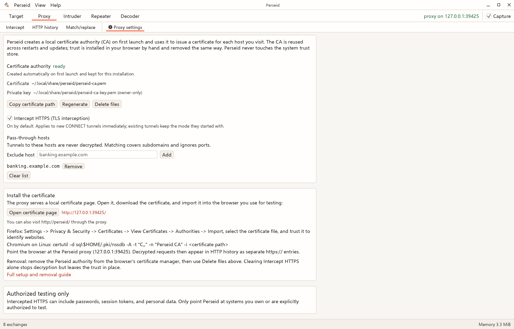

## Intruder

Mark `$$` positions, edit payload sets, and review generated requests and
responses from a finished Sniper attack.

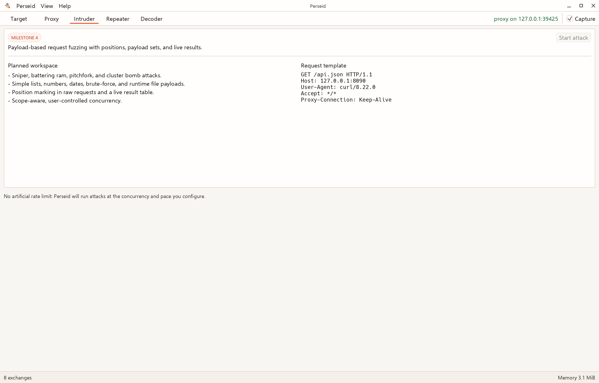

## Repeater

Replay edited requests directly to a target, independently of the proxy listener.

## Sequencer

Load an existing token sample or capture tokens from new proxy responses. The
tab shows token count and length, the sample table, and the capture settings.

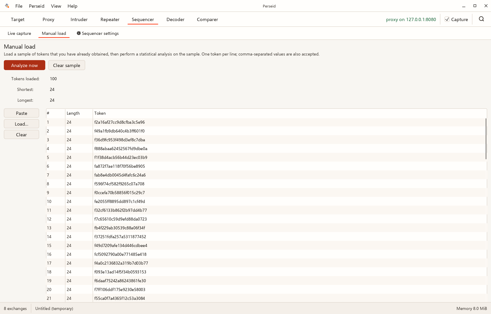

## Sequencer result

The result window summarizes overall randomness, charts effective entropy
across the five significance levels, and reports sample reliability. Character
and bit details, plus analysis settings, are separate tabs.

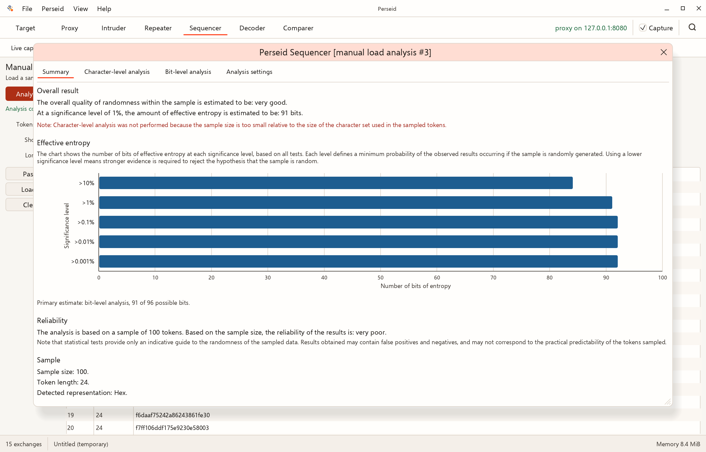

## Decoder

Build a local encode/decode/hash chain with one panel per transformation.

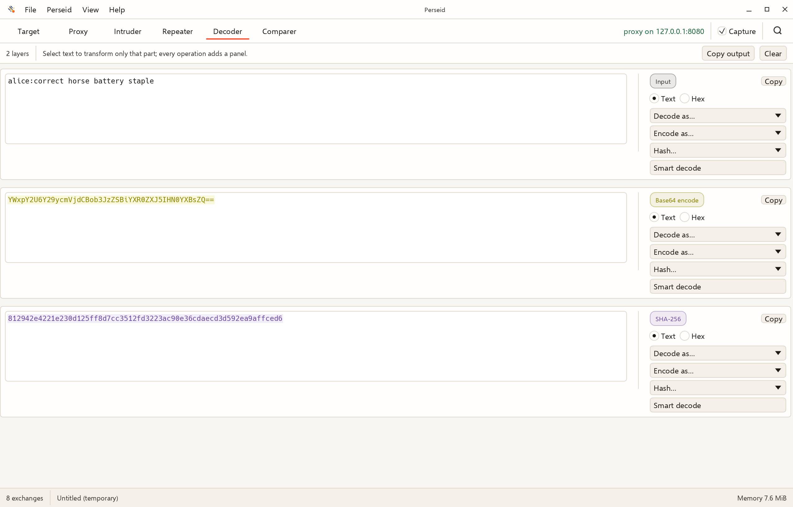

## Comparer

Both item tables show one shared collection. Select a different row in each
table, then compare the pair word by word or byte by byte.

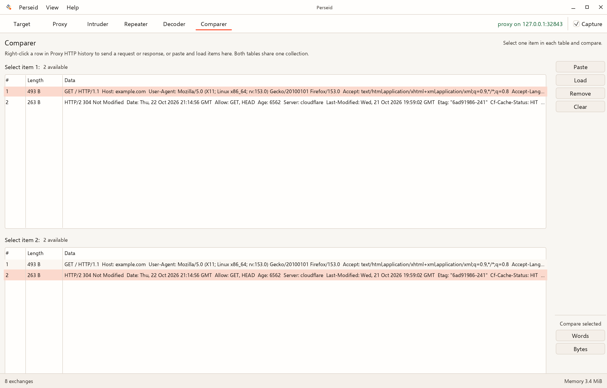

## Comparer result

The result window shows paired Text or Hex views with modified, deleted, and
added data highlighted. Use the arrows to move between differences and
**Sync views** to keep both panes aligned.

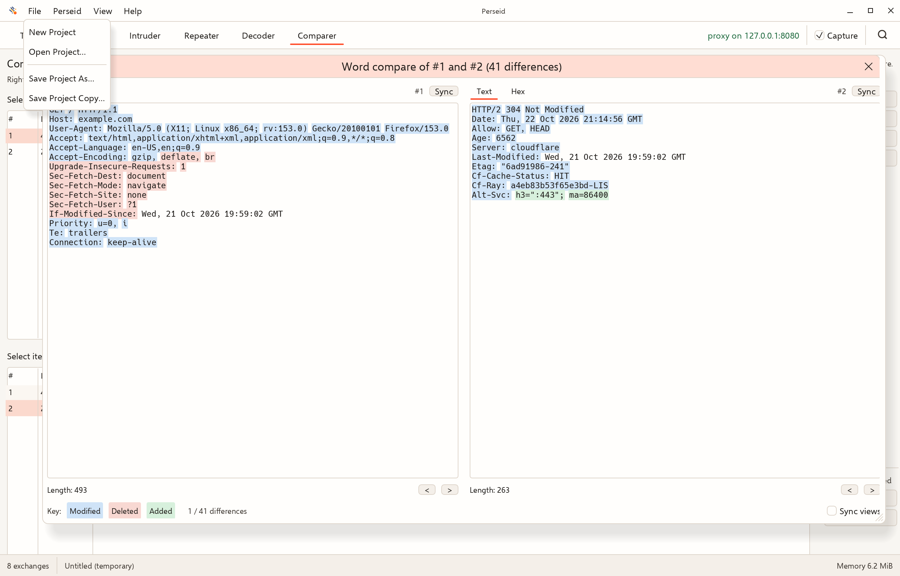

## Memory usage

Allocator heap in use and peak, not total process RSS. See the
[measurement guide](performance.md) for the distinction.

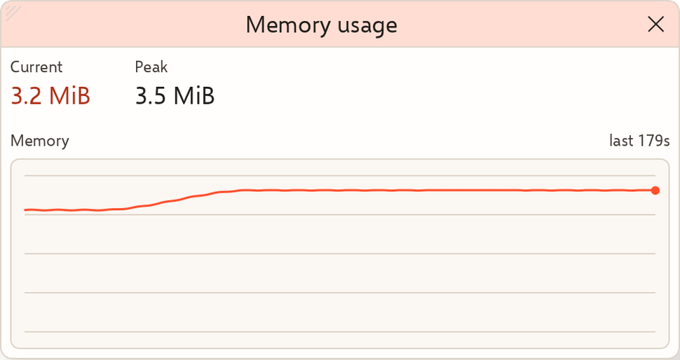

## Recording the demo animation

Run **Actions > Record demo animation > Run workflow**, selecting the branch to
record. The workflow is manual-only and does not run on pull requests. It
builds Perseid on a Linux runner, starts a loopback-only synthetic target, and
records a real desktop session under Xvfb. The
[storyboard](demo-gif-script.md) is aimed at first-time users: it follows one
captured export through Repeater, Intruder, Decoder, and Comparer, using the
synthetic target's base64 responses. The pointer travels between controls
instead of jumping. The capture is downscaled to 1280×820 at 12 fps and encoded
as an animated WebP with `img2webp`; the workflow keeps it under two minutes and
2.5 MB so it stays practical for the README. Before publishing, the workflow
verifies that the edited Repeater and Intruder requests reached the local
target.

The current approved recording is checked in as
[`images/perseid-demo.webp`](images/perseid-demo.webp) (1280×820, about 87
seconds, 1.6 MB) and used as the [project README](../README.md) hero image. To
update it, run the workflow manually, download `perseid-demo-webp` from the
run, review it, and replace that file. The artifact expires after 30 days.
Failed runs upload diagnostic logs and the partial recording for seven days.
All traffic and values in this workflow are synthetic; the workflow does not
use local files or data from your machine. Animated WebP is supported by
current Chrome, Firefox, Safari, and Edge, and renders in GitHub Markdown.
